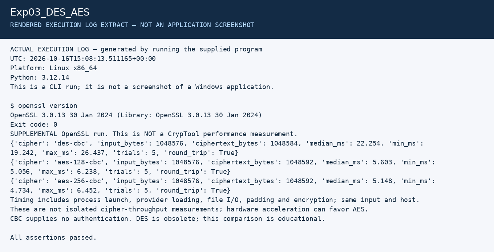

# Experiment 3: DES and AES Comparison

| Detail | Information |
|---|---|
| Student | P Ganesh |
| Course | Cryptography — CSL0509 |
| Programme | B.Tech AIML, V Semester |
| Faculty | Mr. Hirendra Singh Sengar |
| Academic year | 2026–27 |

**Evidence status:** OpenSSL supplemental execution passed. Required CrypTool execution and screenshots are pending.

## Aim

Encrypt and decrypt the same input with DES and AES in CrypTool, then compare security and measured performance.

## Algorithm and comparison

Both are symmetric block ciphers. DES uses 16 Feistel rounds; AES uses substitution, row shifting, column mixing and round-key addition (the final round omits column mixing).

| Property | DES | AES |
|---|---|---|
| Block size | 64 bits | 128 bits |
| Effective key size | 56 bits (64-bit representation includes parity bits) | 128, 192 or 256 bits |
| Rounds | 16 | 10, 12 or 14 |
| Security | Obsolete; small key space | Appropriate with secure modes and sound key management |
| Mode for this controlled comparison | CBC with padding | CBC with padding |

CBC does not authenticate data. Use authenticated encryption such as AES-GCM for new applications; the CBC exercise only compares cipher behavior.

## CrypTool procedure — still to execute

1. Open CrypTool 2.1. Search the Startcenter templates for `DES` and `AES`; use encryption/decryption templates that expose input, key, IV and output.
2. Enter the same text, `HELLO WORLD - CSL0509`, in each workflow. Keep the encoding identical (UTF-8/ASCII for this sample).
3. Select CBC and the same padding convention, such as PKCS#7, in both workflows. If a template exposes different settings, record them instead of silently assuming equivalence.
4. Enter the demonstration keys as **hex bytes**, not UTF-8 strings: DES `133457799BBCDFF1`, AES-128 `000102030405060708090A0B0C0D0E0F`. These published keys are only test inputs.
5. Set the DES IV to `0001020304050607` (8 bytes) and AES IV to `000102030405060708090A0B0C0D0E0F` (16 bytes). Fixed IVs are solely for reproducible lab comparison, not real messages.
6. Run encryption and show the ciphertext in hexadecimal. Change to decryption and confirm the exact original bytes using the corresponding key and IV.
7. For performance, repeat with the same larger input file. Run each workflow once to warm up, then five measured runs. Record machine, version, input size, mode, padding and each duration. Report the median. If the timer resolution is too coarse, increase input size; do not report rounded zero as a reliable measurement.

## Supplementary execution already recorded

From the repository root:

```powershell
python Exp03_DES_AES/openssl_comparison.py
```

The script compares DES-CBC, AES-128-CBC and AES-256-CBC on 1 MiB and checks exact decryption. [benchmark.csv](results/benchmark.csv) contains actual five-trial statistics. DES requires the OpenSSL legacy provider. The timing includes process startup and file I/O and is **not** a CrypTool timing result. A faster run does not establish greater cryptographic security.

## Conclusion

DES's limited key space makes it unsuitable for sensitive data. AES offers substantially larger keys. Actual speed depends on implementation, acceleration, mode and workload. The required CrypTool comparison remains pending.

## Required screenshots to finish the submission

These are the captures still needed from the specified tool. Do not rename a rendered log image as a tool screenshot.

- [ ] `01_DES_Setup_Encryption.png` — DES input, key/IV, mode and encrypted output
- [ ] `02_DES_Decryption.png` — original text recovered
- [ ] `03_AES_Setup_Encryption.png` — AES configuration and ciphertext
- [ ] `04_AES_Decryption.png` — original text recovered
- [ ] `05_CrypTool_Timing.png` — recorded CrypTool durations and input size

Store the captures in a `screenshots` subfolder and add relative image links after the actual files exist.

## Recorded execution evidence

[Full execution log](results/execution.txt) · [Machine-readable results](results/summary.json)

The image below is a **rendered extract of the actual execution log**, not a screenshot of CrypTool, VS Code, Kali or Wireshark.



## References

- [CrypTool function catalogue](https://www.cryptool.org/en/functions/)
- [OpenSSL enc](https://docs.openssl.org/3.0/man1/openssl-enc/)
