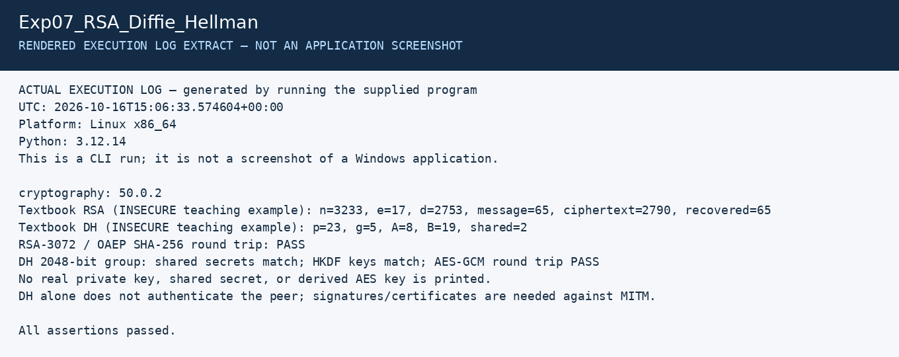

# Experiment 7: RSA and Diffie–Hellman in Python

| Detail | Information |
|---|---|
| Student | P Ganesh |
| Course | Cryptography — CSL0509 |
| Programme | B.Tech AIML, V Semester |
| Faculty | Mr. Hirendra Singh Sengar |
| Academic year | 2026–27 |

**Evidence status:** Code executed successfully in Linux CLI. Run it in the required VS Code environment and capture screenshots.

## Aim

Implement RSA arithmetic and Diffie–Hellman key exchange, then demonstrate library-based RSA-OAEP and finite-field DH with a derived AES key.

## Setup and run in VS Code

Open the repository folder. In the integrated terminal:

```powershell
python -m venv .venv
.venv\Scripts\python.exe -m pip install -r requirements.txt
.venv\Scripts\python.exe Exp07_RSA_Diffie_Hellman/main.py
```

Select `.venv` as the Python interpreter if VS Code asks. On Linux use `.venv/bin/python` instead.

## Algorithms

**RSA teaching example:** choose p=61 and q=53; calculate n=3233 and φ(n)=3120. Choose e=17 and find d=2753. Encrypt m=65 as `c = m^e mod n = 2790`; decrypt with `m = c^d mod n = 65`. These tiny parameters and raw RSA are insecure teaching examples only.

**DH teaching example:** p=23, g=5, Alice's a=6 and Bob's b=15 give public values A=8, B=19. Both compute shared value 2 using modular exponentiation. The code then uses a known 2048-bit MODP group, random private keys and HKDF-SHA256 for the library demonstration.

## Procedure and results

1. Run both toy examples and check the arithmetic.
2. Generate RSA-3072 and encrypt/decrypt bytes with OAEP/SHA-256; exact comparison passes.
3. Generate independent DH keys for Alice and Bob in RFC 3526 Group 14.
4. Exchange public keys and calculate each shared secret independently.
5. Derive matching 32-byte AES keys with HKDF and the same salt/context.
6. Encrypt using Alice's derived key and decrypt with Bob's key using AES-GCM; the round trip passes.

The installed cryptography version warns that finite-field DH is deprecated; this experiment retains it to illustrate the assigned algorithm. Modern applications generally use a modern authenticated key-exchange protocol. The actual secret values are not logged.

## Limitation

Equal DH secrets demonstrate agreement, not peer identity. Without authenticated public keys, DH is vulnerable to a man-in-the-middle attack. This standalone demonstration is not a production secure channel.

## Required screenshots to finish the submission

These are the captures still needed from the specified tool. Do not rename a rendered log image as a tool screenshot.

- [ ] `01_VSCode_Setup.png` — code, interpreter and dependency setup
- [ ] `02_RSA_DH_Output.png` — toy arithmetic, RSA and DH/HKDF checks

Store the captures in a `screenshots` subfolder and add relative image links after the actual files exist.

## Recorded execution evidence

[Full execution log](results/execution.txt) · [Machine-readable results](results/summary.json)

The image below is a **rendered extract of the actual execution log**, not a screenshot of CrypTool, VS Code, Kali or Wireshark.



## References

- [RFC 3526 groups](https://www.rfc-editor.org/rfc/rfc3526)
- [cryptography DH](https://cryptography.io/en/stable/hazmat/primitives/asymmetric/dh/)
