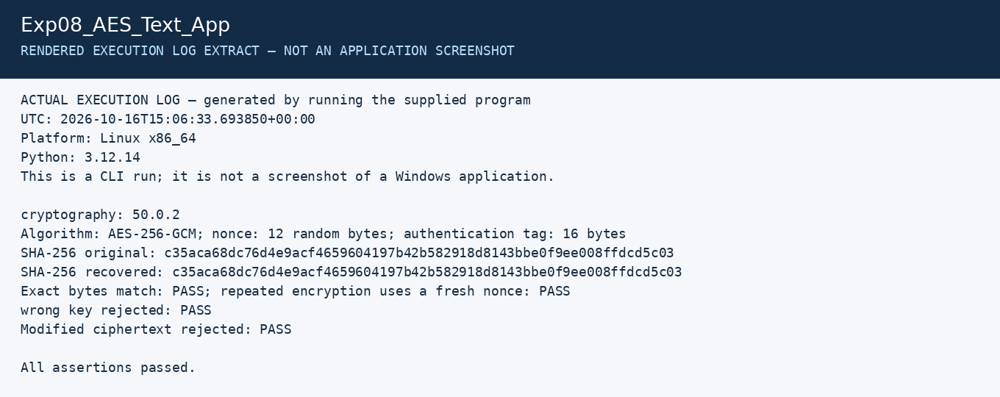

# Experiment 8: AES Text Encryption and SHA-256

| Detail | Information |
|---|---|
| Student | P Ganesh |
| Course | Cryptography — CSL0509 |
| Programme | B.Tech AIML, V Semester |
| Faculty | Mr. Hirendra Singh Sengar |
| Academic year | 2026–27 |

**Evidence status:** Application and positive/negative tests executed in Linux CLI. VS Code screenshots are pending.

## Aim and design

Secure UTF-8 text with AES-256-GCM and compare original/recovered SHA-256 digests. The ciphertext envelope stores a random 12-byte nonce and ciphertext with its 16-byte authentication tag. The key is kept separately. A fixed format label is authenticated as associated data.

## Run the demonstration

After installing `requirements.txt`, run from the repository root in VS Code:

```powershell
python Exp08_AES_Text_App/app.py demo
```

## Use the application with your own lab text

Create a private local directory and an input text file, then run:

```powershell
mkdir .private
python Exp08_AES_Text_App/app.py keygen --key .private/aes.key
python Exp08_AES_Text_App/app.py encrypt --key .private/aes.key --input message.txt --output .private/message.enc.json
python Exp08_AES_Text_App/app.py decrypt --key .private/aes.key --input .private/message.enc.json --output .private/recovered.txt
```

Use a new output filename if one already exists. The application refuses to overwrite existing output/key files. Keep the `.private` directory local; never upload its AES key. The demo uses a temporary in-memory key and cannot decrypt its saved envelope in a later process; the commands above retain a local key for that purpose.

## Algorithm and verification

1. Read text bytes and calculate SHA-256.
2. Generate a fresh nonce for encryption under the AES key.
3. Encrypt and authenticate the bytes using AES-GCM.
4. Decode and validate the envelope when decrypting.
5. Verify the authentication tag before returning plaintext.
6. Compare recovered bytes and hashes with the original.

The demo passed Unicode and empty-message round trips, verified a fresh nonce on a repeated encryption, and rejected a wrong key and a modified ciphertext. The full output and digest are in `results`. SHA-256 is a comparison aid; GCM's keyed tag provides message authentication. Never intentionally reuse a nonce with the same GCM key.

## Required screenshots to finish the submission

These are the captures still needed from the specified tool. Do not rename a rendered log image as a tool screenshot.

- [ ] `01_VSCode_AES_App.png` — application code and interpreter
- [ ] `02_AES_Round_Trip.png` — original/recovered messages and hashes
- [ ] `03_AES_Tamper_Check.png` — wrong key and modified ciphertext rejected

Store the captures in a `screenshots` subfolder and add relative image links after the actual files exist.

## Recorded execution evidence

[Full execution log](results/execution.txt) · [Machine-readable results](results/summary.json)

The image below is a **rendered extract of the actual execution log**, not a screenshot of CrypTool, VS Code, Kali or Wireshark.



## References

- [cryptography authenticated encryption](https://cryptography.io/en/stable/hazmat/primitives/aead/)
