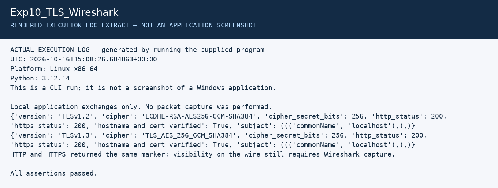

# Experiment 10: HTTPS and TLS Analysis

| Detail | Information |
|---|---|
| Student | P Ganesh |
| Course | Cryptography — CSL0509 |
| Programme | B.Tech AIML, V Semester |
| Faculty | Mr. Hirendra Singh Sengar |
| Academic year | 2026–27 |

**Evidence status:** Local HTTP/TLS 1.2/TLS 1.3 exchanges executed. Wireshark capture and packet-level analysis are pending.

## Aim

Capture an HTTPS exchange and identify the TLS handshake, server certificate and negotiated cipher suite.

## Local fixture already tested

```powershell
python Exp10_TLS_Wireshark/run_fixture.py
```

The saved CLI run negotiated TLS 1.2 and TLS 1.3 and verified a temporary localhost certificate. It demonstrates real application exchanges, not a packet capture. `summary.json` records the actual negotiated suites. A capture could not be performed in the preparation environment because raw-packet capture permission was unavailable.

## Wireshark procedure on Windows

1. Install/open Wireshark with Npcap loopback support. Keep OpenSSL on PATH.
2. From the repository root start the fixture:

   ```powershell
   python tools/local_web_lab.py
   ```

3. The script prints a temporary certificate path. Keep this terminal open. It serves only your own loopback interface; by default HTTPS uses TLS 1.2 so its initial certificate message can be inspected without session secrets.
4. Start a Wireshark capture on **Adapter for loopback traffic capture**. Capture filter: `tcp port 8443`.
5. In another PowerShell window, replace the certificate path below with the exact path printed by the script:

   ```powershell
   curl.exe --cacert "C:\actual\temporary\cert.pem" https://127.0.0.1:8443/CSL0509_LOCAL_LAB_ONLY
   ```

6. Stop capture and save it as `tls12_lab.pcapng` in this experiment folder. If port 8443 is not decoded automatically, use **Analyze → Decode As** to associate that TCP port with TLS.
7. Use display filters below and expand the handshake fields. Record the offered protocols/suites in ClientHello and the actual selected suite/version in ServerHello. Inspect Certificate for subject, issuer, validity and SAN.
8. Observe application-data records. Encrypted payload is not readable HTTP without session keys; packet lengths and endpoints remain observable.
9. Stop the fixture with Ctrl+C. Optionally restart using `python tools/local_web_lab.py --tls13` and capture a second exchange. In TLS 1.3 the certificate handshake message is encrypted; its absence in a passive undecrypted view is expected. Do not label a TLS 1.3 record-layer legacy version as the negotiated protocol version.

| Display filter | Purpose |
|---|---|
| `tcp.port == 8443` | Limit to the test server |
| `tls.handshake.type == 1` | ClientHello |
| `tls.handshake.type == 2` | ServerHello |
| `tls.handshake.type == 11` | Certificate where visible/decrypted |
| `tls.record.content_type == 23` | Application-data record type; may carry encrypted handshake in TLS 1.3 |

## Observations to record after capture

Record packet numbers, TLS version, selected cipher, certificate subject/issuer, SAN, validity dates and whether the payload is readable. With TLS 1.3, cipher-suite names describe symmetric encryption and hash; key exchange and certificate authentication are negotiated separately. The fixture's self-signed certificate is trusted only by explicitly passing its certificate to the test client.

## Pending result

No `.pcapng` or Wireshark screenshots have been generated here. Complete the capture steps before claiming packet-level analysis is finished.

## Required screenshots to finish the submission

These are the captures still needed from the specified tool. Do not rename a rendered log image as a tool screenshot.

- [ ] `01_Wireshark_Interface.png` — version, selected loopback interface and filter
- [ ] `02_TLS_Hello.png` — ClientHello and ServerHello selected suite/version
- [ ] `03_TLS_Certificate.png` — TLS 1.2 certificate fields
- [ ] `04_TLS_Application_Data.png` — encrypted records and successful client response

Store the captures in a `screenshots` subfolder and add relative image links after the actual files exist.

## Recorded execution evidence

[Full execution log](results/execution.txt) · [Machine-readable results](results/summary.json)

The image below is a **rendered extract of the actual execution log**, not a screenshot of CrypTool, VS Code, Kali or Wireshark.



## References

- [Wireshark TLS](https://wiki.wireshark.org/TLS)
- [Loopback capture](https://wiki.wireshark.org/CaptureSetup/Loopback)
- [TLS filter reference](https://www.wireshark.org/docs/dfref/t/tls.html)
