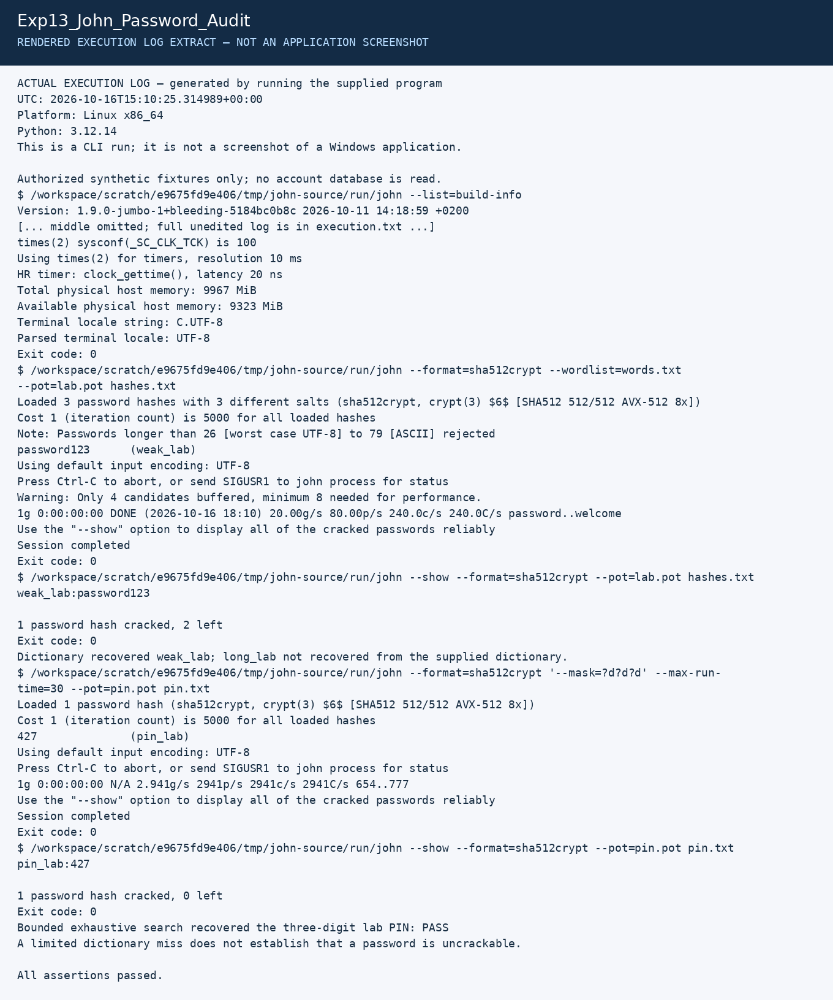

# Experiment 13: Password Auditing with John the Ripper

| Detail | Information |
|---|---|
| Student | P Ganesh |
| Course | Cryptography — CSL0509 |
| Programme | B.Tech AIML, V Semester |
| Faculty | Mr. Hirendra Singh Sengar |
| Academic year | 2026–27 |

**Evidence status:** Actual John dictionary and bounded PIN tests passed on Linux. Required Kali environment/screenshots remain pending.

## Aim

Audit only synthetic lab password hashes with a dictionary and a bounded exhaustive search, and explain the limits of the findings.

## Setup and run on Kali

Check/install John jumbo, Python and OpenSSL in your Kali lab VM, then run:

```bash
john --list=build-info
python3 Exp13_John_Password_Audit/run.py
```

If John is not on PATH, use `--john /actual/path/to/john`. The preparation run built the official Openwall repository at commit `5184bc0b8c105f8c5978b112e723d65b2de3e63e`. That build is not bundled. The evidence log records its version and build information.

## Procedure and algorithm

1. The script creates three synthetic users and SHA-512-crypt hashes with known lab salts. It never reads `/etc/shadow` or any real account database.
2. Try a four-entry local dictionary using `john --format=sha512crypt --wordlist=words.txt`.
3. Use `john --show` to distinguish reliably recovered passwords from progress output.
4. For a separate synthetic three-digit PIN hash, enumerate `?d?d?d`: at most 1,000 candidates. Use a 30-second limit and a separate temporary pot file.
5. Check that the expected weak password and PIN are found, and document what the dictionary did not contain.

## Observed results

| Test | Observed outcome |
|---|---|
| Four-entry dictionary | `weak_lab:password123` recovered |
| Three-digit mask | `pin_lab:427` recovered |
| Longer sample | Not recovered from this small dictionary |

The samples and salts are deliberately public teaching fixtures. The recorded SHA-512-crypt iteration count is part of the output, not a recommended production password policy. Salt prevents reuse of a single precomputed mapping across accounts but does not stop per-account guessing. A dictionary miss does not demonstrate that a password is uncrackable. The mask test is bounded exhaustive search over three digits, not a test of all possible passwords.

## Conclusion

Predictable passwords and short PINs can be recovered even when stored as salted hashes. Password length, unpredictability and the cost of the password-hashing algorithm all matter.

## Required screenshots to finish the submission

These are the captures still needed from the specified tool. Do not rename a rendered log image as a tool screenshot.

- [ ] `01_Kali_John_Setup.png` — Kali environment and John build/version
- [ ] `02_Dictionary_Audit.png` — synthetic hashes and dictionary/show results
- [ ] `03_Bounded_PIN_Audit.png` — mask command and recovered synthetic PIN

Store the captures in a `screenshots` subfolder and add relative image links after the actual files exist.

## Recorded execution evidence

[Full execution log](results/execution.txt) · [Machine-readable results](results/summary.json)

The image below is a **rendered extract of the actual execution log**, not a screenshot of CrypTool, VS Code, Kali or Wireshark.



## References

- [Openwall John usage examples](https://www.openwall.com/john/doc/EXAMPLES.shtml)
- [Official John source](https://github.com/openwall/john)
