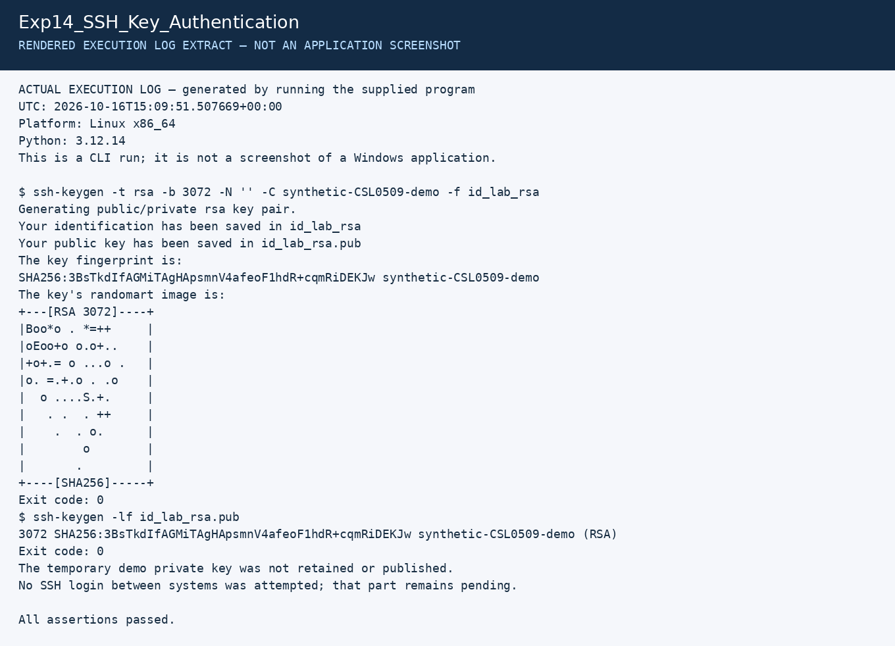

# Experiment 14: SSH/RSA Passwordless Authentication

| Detail | Information |
|---|---|
| Student | P Ganesh |
| Course | Cryptography — CSL0509 |
| Programme | B.Tech AIML, V Semester |
| Faculty | Mr. Hirendra Singh Sengar |
| Academic year | 2026–27 |

**Evidence status:** RSA key generation verified locally. Authentication between two Linux systems and Kali screenshots are pending.

## Aim

Generate an RSA SSH key pair on a client and configure public-key authentication to a second Linux lab system.

## Supplementary key-generation check

```bash
python3 Exp14_SSH_Key_Authentication/generate_demo_key.py
```

This generates and fingerprints a temporary RSA-3072 key, retains only its public key and deletes the temporary private key. It does not attempt a remote SSH login.

## Two-system procedure

Use two owned lab VMs on a host-only network. In the commands below replace `labuser` and `192.168.56.10` with the server's actual non-root account and IP.

1. On the server enable the OpenSSH service and record its listening status and IP:

   ```bash
   sudo systemctl enable --now ssh
   systemctl status ssh --no-pager
   ip -brief address
   ```

2. On the client generate a separate lab key. Enter a passphrase when prompted:

   ```bash
   ssh-keygen -t rsa -b 3072 -f ~/.ssh/csl0509_rsa -C "CSL0509-lab"
   ```

3. On the server, check its host-key fingerprint locally with `ssh-keygen -lf /etc/ssh/ssh_host_ed25519_key.pub`. Compare it when the client first connects. Do not disable host-key checking.
4. Install only the public key in the target account:

   ```bash
   ssh-copy-id -i ~/.ssh/csl0509_rsa.pub labuser@192.168.56.10
   ```

5. Load the private key into the local agent so it can be used without repeated passphrase prompts:

   ```bash
   eval "$(ssh-agent -s)"
   ssh-add ~/.ssh/csl0509_rsa
   ```

6. Test authentication with account-password fallback disabled:

   ```bash
   ssh -v -o BatchMode=yes -o PreferredAuthentications=publickey -o PasswordAuthentication=no -o IdentitiesOnly=yes -i ~/.ssh/csl0509_rsa labuser@192.168.56.10 'whoami; hostname'
   ```

7. Confirm the debug output identifies public-key authentication and the remote identity is correct. After the test, `ssh-add -d ~/.ssh/csl0509_rsa` removes this key from the agent.

`~/.ssh` should be owned by the account with mode 700 and `authorized_keys` mode 600. If authentication fails, inspect ownership, permissions and server logs. Do not globally weaken SSH settings to make the test pass.

## Algorithm and interpretation

The server stores a public key. The client proves possession of the corresponding private key by signing the authentication exchange; it does not send that private key. RSA keys can use RSA-SHA2 signatures: do not enable legacy SHA-1 `ssh-rsa` signatures just because the key type is RSA. A key passphrase protects the key file; passwordless server login does not require an unprotected private key.

## Pending result

Record the two actual hostnames/IPs, verified host-key fingerprint and successful public-key login before marking this experiment complete.

## Required screenshots to finish the submission

These are the captures still needed from the specified tool. Do not rename a rendered log image as a tool screenshot.

- [ ] `01_Kali_Two_Hosts.png` — client/server identities and server SSH status
- [ ] `02_RSA_Key_Setup.png` — key generation and public-key installation
- [ ] `03_PublicKey_Login.png` — successful batch-mode login using publickey

Store the captures in a `screenshots` subfolder and add relative image links after the actual files exist.

## Recorded execution evidence

[Full execution log](results/execution.txt) · [Machine-readable results](results/summary.json)

The image below is a **rendered extract of the actual execution log**, not a screenshot of CrypTool, VS Code, Kali or Wireshark.



## References

- [OpenSSH ssh-keygen](https://man.openbsd.org/ssh-keygen)
- [OpenSSH server configuration](https://man.openbsd.org/sshd_config)
